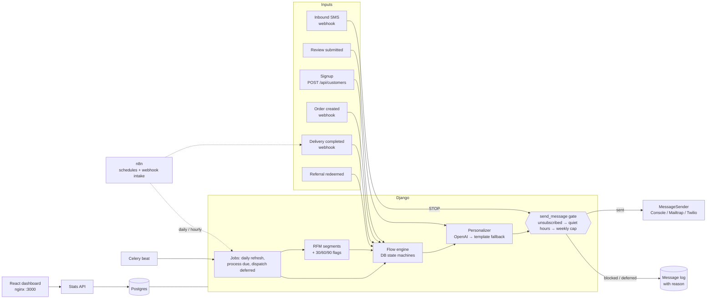

# Win-Back & Loyalty Engine

A retention backend for a same-day delivery store (the demo brand is *Swift Basket*). It segments customers by RFM, runs automated lifecycle flows (welcome, first-order nudge, win-back escalation, referrals, review requests with low-rating triage), personalizes copy with OpenAI behind a template fallback, and sends every message through one compliance gate: STOP handling, quiet hours and weekly caps. A React dashboard shows segments, message volume and the win-back reactivation rate.

## The problem

Delivery apps live on repeat orders, but most customers drift away after one or two. The fix is well known: welcome new signups, nudge them to a first order, win back lapsed buyers with escalating offers, turn happy customers into reviews and referrals. The hard parts are the ones that go wrong quietly:

- **Over-messaging.** Three flows decide independently to text the same customer this week, they complain, and the carrier starts filtering you.
- **Messaging at 2 a.m.** A batch job runs in UTC and texts customers in the middle of their night.
- **Ignoring STOP**, or sending a win-back offer to someone who ordered an hour ago.
- **AI copy that invents a discount** the business never approved.
- **No proof it works.** Nobody can say what share of lapsed customers came back.

This engine makes those rules structural instead of hoping every flow remembers them.

## Architecture



The flows are explicit state machines stored in the database (`FlowEnrollment`: flow, step, `next_run_at`, status). A scheduler (Celery beat out of the box, or n8n) runs whatever is due. Every outbound message goes through `send_message()`, the only path to a sender. Details: [docs/architecture.md](docs/architecture.md).

## Quickstart

You need Docker with Compose v2. No API keys: mock senders and template copy are the default.

```bash
docker compose up --build
docker compose exec api python manage.py seed_demo     # ~1 minute
```

`seed_demo` creates about 2,000 Faker customers and 8,000 orders shaped like real cohorts (champions through lapsed one-time buyers), then replays the last 45 days of lifecycle activity through the real engine, so the dashboard has history. Use `--simulate-days 0` to skip the replay, `--flush` to reseed, and `--seed N` for a different but reproducible dataset.

| Service | URL |
|---|---|
| Dashboard | http://localhost:3000 |
| API | http://localhost:8000 (`/health`) |
| n8n | http://localhost:5678 (see [n8n/README.md](n8n/README.md)) |
| Mock messages | `docker compose logs -f worker api`: every sent message is printed by the process that sent it |

### Try the flows

```bash
API=http://localhost:8000/api
# Signup → welcome now, first-order nudge in 2 days
curl -X POST $API/customers -H 'Content-Type: application/json' \
  -d '{"email": "maya@example.com", "first_name": "Maya", "phone": "555-010-7788", "timezone": "America/Chicago"}'

# Order (idempotent by event_id): cancels any active win-back, rewards a referrer
curl -X POST $API/webhooks/order-created -H 'Content-Type: application/json' \
  -d '{"event_id": "evt-1", "order_id": "ord-1", "customer_email": "maya@example.com", "total": "34.50"}'

# Delivery → review request in 3 hours; a 1-3 star rating gets a private fix-it message + needs_followup tag
curl -X POST $API/webhooks/delivery-completed -H 'Content-Type: application/json' \
  -d '{"event_id": "dlv-1", "order_id": "ord-1"}'

# STOP (Twilio form fields or JSON): unsubscribes and cancels every enrollment
curl -X POST $API/webhooks/inbound-sms -d 'MessageSid=SM1' --data-urlencode 'From=+15550107788' -d 'Body=Stop'

# Run due flow steps now instead of waiting for the scheduler
curl -X POST $API/flows/process-due
```

### Real providers

Set `USE_MOCKS=false` and fill in `OPENAI_API_KEY`, the `MAILTRAP_*` settings (email) and the `TWILIO_*` settings (SMS) in `.env`. A missing provider key never falls back to a mock: the gate records that message as `failed` with the configuration error. A missing or failing OpenAI call always falls back to the template copy. Read [docs/deliverability.md](docs/deliverability.md) before sending real email or SMS.

## Flows

| Flow | Trigger | Steps | Stops when |
|---|---|---|---|
| **Welcome** | Signup | Welcome now → first-order nudge with 10% off at +2 days | The customer has already ordered (nudge skipped) |
| **Win-back** | Daily job: 60+ days since last order, at least 1 past order, 90-day cooldown | Reminder → 10% offer at +4 days → 20% final offer at +7 days | **Any new order**, at once (order webhook), and re-checked at each step |
| **Referral** | `POST /api/referrals/redeem` with a code | Friend gets 15% off the first order; when it arrives, the referrer gets a 15% reward | Once per friend; no self-referral or existing buyers |
| **Review** | Delivery-completed webhook | Review request at +3 hours → rating 4–5: public review link; 1–3: private fix-it message + `needs_followup` tag | One review per order |

Discount values live in `DISCOUNTS` in the settings. Copy only ever references them through placeholders, so neither the template nor the model can promise a discount that doesn't exist.

## The send gate

`compliance/gate.py`, in this order:

1. **Unsubscribed** → blocked (`unsubscribed`).
2. **Quiet hours** (21:00–08:00 in the customer's own timezone) → deferred to the next 08:00 and re-checked against every rule when released.
3. **Weekly cap** (3 sent per rolling 7 days) → blocked (`weekly_cap`).
4. Send through the channel's `MessageSender`. Provider errors are stored as `failed`.

Every attempt, blocked or not, is a `Message` row with its status, reason, and whether the copy was AI or template.

## API

| Method | Path | Purpose |
|---|---|---|
| `POST` | `/api/customers` | Signup; starts the welcome flow (201, or 200 for an existing email) |
| `POST` | `/api/webhooks/order-created` | New order; idempotent by `event_id` |
| `POST` | `/api/webhooks/delivery-completed` | Order delivered; schedules the review request |
| `POST` | `/api/webhooks/inbound-sms` | Inbound SMS (Twilio form or JSON); STOP handling |
| `POST` | `/api/reviews` | Submit a rating; routes to public link or private fix-it |
| `POST` | `/api/referrals/redeem` | Redeem a referral code for a new customer |
| `POST` | `/api/flows/process-due` | Run due flow steps (for n8n or cron) |
| `POST` | `/api/segments/refresh` | Recompute segments and enroll win-back candidates |
| `GET` | `/api/stats/overview` | Segments, inactivity, messages by flow, status and block reason, reactivation rate |
| `GET` | `/api/stats/messages-over-time?days=30` | Sent per day per flow |
| `GET` | `/api/messages/recent?limit=20&status=blocked` | Recent messages |
| `GET` | `/health` | Liveness plus a database round-trip |

Management commands: `seed_demo`, `import_csv --customers c.csv --orders o.csv` (see `backend/sample_data/`), and `compute_segments`.

## Configuration

All settings are environment variables ([.env.example](.env.example)). The main ones:

| Variable | Default | Purpose |
|---|---|---|
| `USE_MOCKS` | `true` | Console sender and template copy; no keys needed |
| `QUIET_HOURS_START` / `QUIET_HOURS_END` | `21` / `8` | Customer-local quiet window |
| `WEEKLY_MESSAGE_CAP` | `3` | Max sent per customer per rolling 7 days |
| `DEFAULT_CUSTOMER_TIMEZONE` | `America/New_York` | Used when a customer's timezone is missing or invalid |
| `OPENAI_MODEL` / `OPENAI_TIMEOUT_SECONDS` | `gpt-4o-mini` / `5` | Personalization model; a timeout falls back to the template |
| `REACTIVATION_WINDOW_DAYS` | `14` | Window for counting a win-back as successful |

## Development

```bash
python3 -m venv .venv && .venv/bin/pip install -r backend/requirements-dev.txt
.venv/bin/pre-commit install
cd backend && ../.venv/bin/pytest            # SQLite locally; Postgres in CI
cd frontend && npm install && npm test && npm run dev   # dashboard on :5173, proxies /api to :8000
```

```
backend/
  customers/   signup, seed + CSV import, phone normalization
  orders/      order webhook (stops win-back, rewards referrals)
  segments/    RFM scoring, named segments, inactivity flags
  flows/       engine, flow definitions, schedules, demo replay
  messaging/   Message log, senders, templates, personalization
  compliance/  the send gate, quiet hours, STOP handling, webhook idempotency
  referrals/   codes, redeem, first-order reward
  reviews/     delivery → review request, rating triage
  dashboard/   stats API
frontend/      React + Vite + TypeScript + Recharts dashboard
n8n/           exported workflows + guide
docs/          architecture, decisions, GHL mapping, deliverability, demo script
ghl/           GoHighLevel rebuild screenshots
```

## Demo

> 📽️ _GIF placeholder: seed → dashboard → STOP a customer → watch the gate block and defer → reactivation card._
> Shot list: [docs/demo-script.md](docs/demo-script.md)

GoHighLevel rebuild of the welcome and win-back flows (screenshots in [`/ghl`](ghl)):

| Welcome workflow | Win-back workflow |
|---|---|
| _screenshot: `ghl/welcome-workflow.png`_ | _screenshot: `ghl/winback-workflow.png`_ |

How each flow maps to GHL triggers, tags and pipeline stages: [docs/ghl-mapping.md](docs/ghl-mapping.md).

## Decisions and tradeoffs

Full write-up: [docs/decisions.md](docs/decisions.md).

- **One gate, not per-flow rules.** Compliance is enforced in one function every send must call, so a new flow can't forget it, and every block is logged with its reason.
- **Defer, don't drop, at night.** Quiet-hour messages wait for the customer's morning and are re-checked then, so an overnight STOP still wins.
- **Flows as database state machines.** `next_run_at` and an explicit step survive restarts and deploys, are queryable for the dashboard, and are processed with `SKIP LOCKED`, so beat and n8n can both trigger safely.
- **The model writes words, config sets the numbers.** AI copy must use `{discount}` placeholders. Any amount the model writes itself, a missing placeholder, invalid JSON, over-length copy, an error or a timeout falls back to the template.
- **Mid-rank RFM quintiles.** Ties share a score, and small or uniform populations land in the middle instead of at an arbitrary end.
- **Synthetic but honest demo data.** The 45-day replay drives the real engine and gate; only customer responses (ratings, comeback orders) are simulated.

## What's next

- Email unsubscribe link plus `List-Unsubscribe` one-click headers (required before real email sending; SMS STOP is done).
- Provider signature verification on webhooks (Twilio `X-Twilio-Signature`, a shared secret on store webhooks) and authentication on the stats API.
- Priorities under the weekly cap (for example, a review request outranks a win-back reminder) instead of first come, first served.
- A/B testing of copy and offers per step, with the reactivation rate as the metric.
- Push the segments and tags to GoHighLevel through its API, so the GHL rebuild can run on live data.
