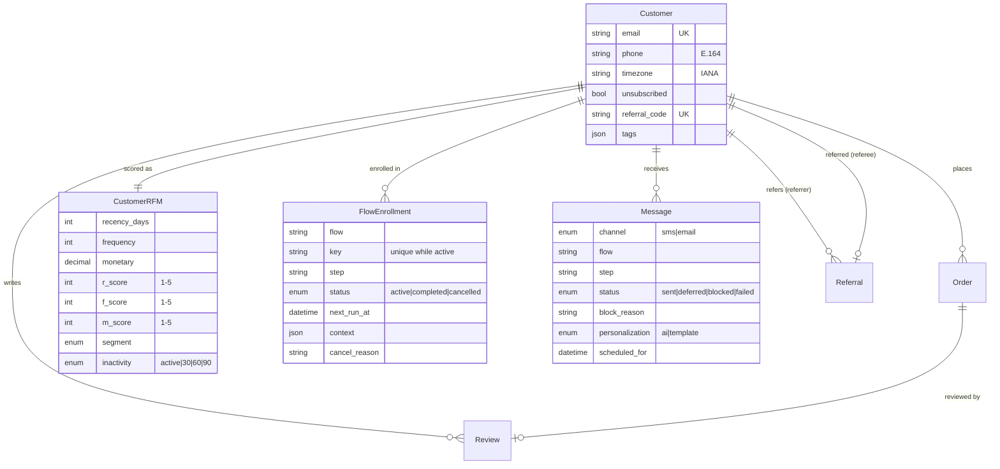
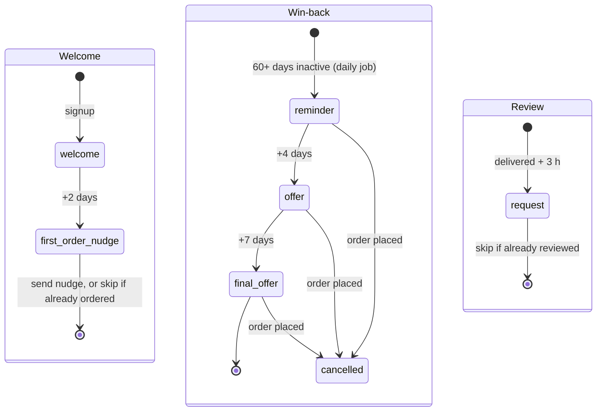
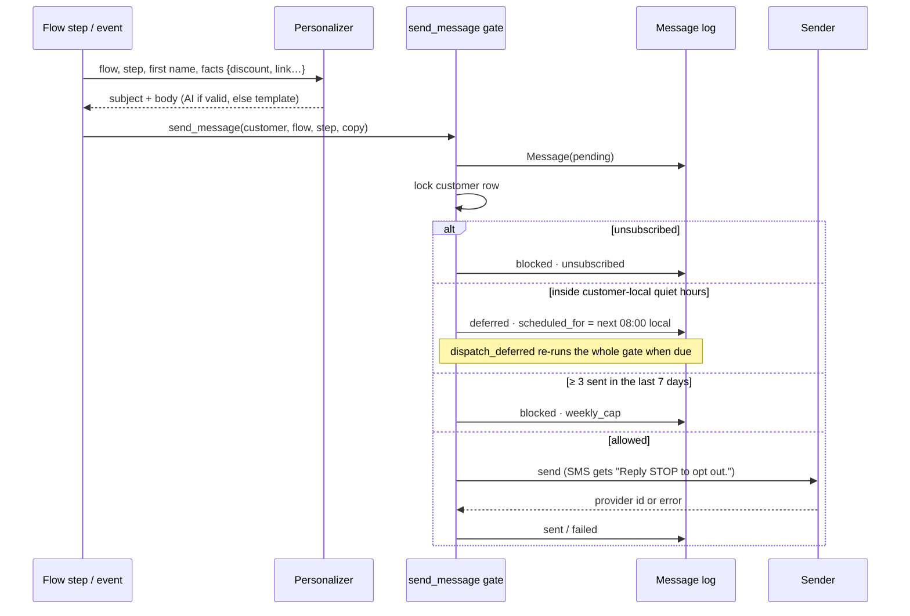

# Architecture

## Services

| Service | Role |
|---|---|
| `api` | Django + DRF behind gunicorn: webhooks, signup, referrals, reviews, stats. Migrates on start. |
| `worker` | Celery worker: runs the scheduled jobs. |
| `beat` | Celery beat schedule: process due enrollments (every minute), dispatch deferred messages (every 5 minutes), daily segment refresh and win-back enrollment (14:00 UTC). |
| `postgres` | All state: customers, orders, RFM snapshots, enrollments, messages, reviews, referrals, webhook event ids. |
| `redis` | Celery broker. |
| `frontend` | React dashboard served by nginx on :3000, proxying `/api` to `api`. |
| `n8n` | Optional scheduler and webhook intake calling the same endpoints (safe to run alongside beat). |

## Data model

## Flow state machines

Each flow is a set of step handlers. A handler returns `Advance(step, delay)`, `Complete()` or `Cancel(reason)`, and the engine applies it to the enrollment.

`process_due_enrollments` selects active enrollments with `next_run_at <= now` and locks each one with `SELECT … FOR UPDATE SKIP LOCKED`. It then runs the step inside its own savepoint. A step that raises is rolled back and retried 15 minutes later, and the enrollment stays active. External events act on enrollments directly: an order cancels win-back, and STOP cancels everything.

## The send gate

The customer row is locked for the duration, so two concurrent flows can't both fit under the weekly cap.

## Segmentation

The daily job, or `POST /api/segments/refresh`:

1. Aggregates each customer's non-cancelled orders up to now: last order, count, spend.
2. Scores R, F and M from 1 to 5 by mid-rank percentile among customers with orders.
3. Assigns a segment with ordered rules: New (first activity within 30 days) → Champions (R≥4, F≥4) → Loyal (R≥3, F≥3) → At Risk (R≤2, F≥3) → Loyal (R≥3) → Hibernating.
4. Sets the inactivity flag from days since the last order (or since signup if they never ordered): 30, 60 or 90.
5. Upserts `CustomerRFM`, then enrolls customers flagged `inactive_60` or `inactive_90` (with at least one order and no win-back in the last 90 days) into win-back.
