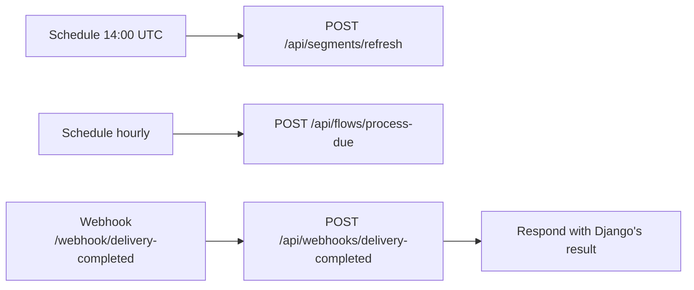

# n8n workflows

Three workflows, exported from n8n 1.123.0 (the version pinned in `docker-compose.yml`). They schedule the engine and take in webhooks. All the logic, and the compliance gate, stays in Django.

| File | Workflow | Trigger | Calls |
|---|---|---|---|
| `workflows/daily-segment-refresh.json` | Winback: daily segment refresh | Every day at 14:00 UTC (10:00 US Eastern, inside send hours), or **Run now** | `POST /api/segments/refresh`: recompute RFM segments and inactivity flags, then enroll newly lapsed customers in win-back |
| `workflows/hourly-due-enrollments.json` | Winback: hourly due enrollments | Every hour, or **Run now** | `POST /api/flows/process-due`: run every flow step that is due |
| `workflows/delivery-completed-intake.json` | Winback: delivery-completed intake | `POST /webhook/delivery-completed` | `POST /api/webhooks/delivery-completed`: mark the order delivered and schedule the review request (+3 h) |



**n8n or Celery beat?** Both work, and running both is safe. Celery beat runs the same jobs out of the box (due enrollments every minute, deferred-message dispatch every 5 minutes, the segment refresh daily), so the project works without n8n. Due enrollments are claimed with row locks (`SKIP LOCKED`), and win-back enrollment is deduplicated, so overlapping triggers never send twice. Use n8n when operators want to see or change the schedule without a deploy.

## Setup with docker compose

1. `docker compose up --build`. On the n8n container's **first** start, all three files are imported from this folder. A marker file then stops later restarts from overwriting changes made in the editor.
2. Open http://localhost:5678 and create the local owner account (stored only in the `n8n-data` volume).
3. Open each workflow and activate it from the top bar (the *Active* toggle, or *Publish* in newer n8n versions). No credentials are needed: every call goes to the `api` service on the compose network.
4. To run a scheduled job right now, open it and click **Execute workflow** (the *Run now* trigger).

Try the webhook intake. `order_id` is the order's external id, e.g. one created through `POST /api/webhooks/order-created`:

```bash
curl -X POST http://localhost:5678/webhook/delivery-completed \
  -H 'Content-Type: application/json' \
  -d '{"event_id": "dlv-1001", "order_id": "ord-1001"}'
# → {"duplicate": false, "review_request_at": "..."}; sending the same event_id again → {"duplicate": true}
```

## Importing manually (n8n outside this compose stack)

- **Editor:** *Workflows → Import from File*, then pick each JSON file.
- **CLI:** `n8n import:workflow --separate --input=./workflows`

Then change the `http://api:8000` URLs in the HTTP Request nodes to wherever the Django API is reachable.

## Re-importing after changing the JSON here

```bash
docker compose exec n8n rm /home/node/.n8n/.workflows-imported
docker compose restart n8n
```

This overwrites the workflows with the same ids.

## Exporting changes back into the repo

```bash
docker compose exec n8n n8n export:workflow --id=winbackSegments1 --pretty --output=/tmp/wf.json
docker compose cp n8n:/tmp/wf.json ./n8n/workflows/daily-segment-refresh.json
```

Before committing, remove the instance-specific fields the export adds (`shared`, `createdAt`, `updatedAt`, `activeVersionId`, `versionCounter`, `triggerCount`, `isArchived`, `staticData`, `meta`, `pinData`, `tags`, `description`).
